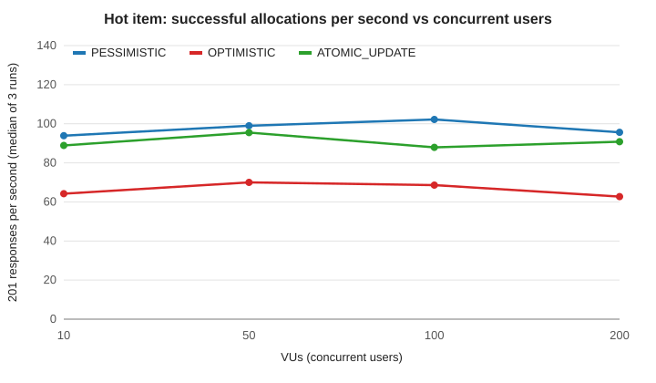
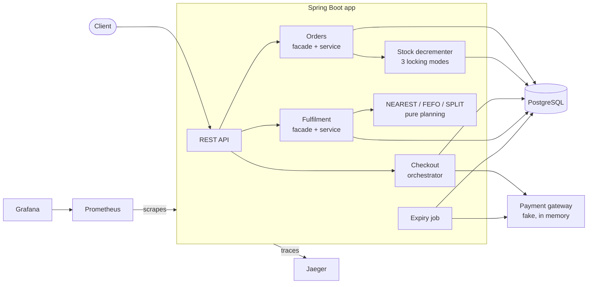
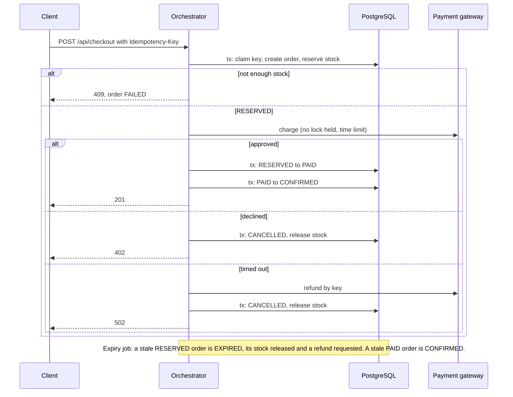
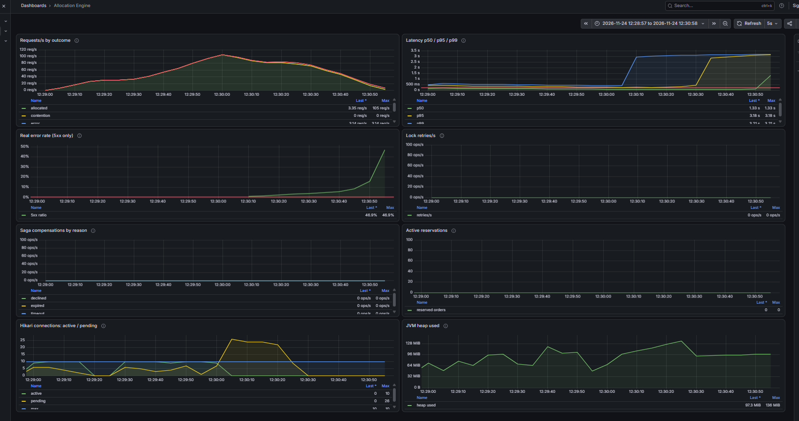

# Order Allocation & Transaction Engine

**Allocates orders against limited stock under concurrent requests, without overselling, and without applying a retried
request twice.**

[](https://github.com/ChamaniNiroshani/order-allocation-engine/actions/workflows/ci.yml)

All three locking strategies are tested with **twice as much ordered at once as is in stock, and none may oversell**
([test](src/test/java/com/chamani/order_allocation_engine/AbstractAllocationConcurrencyTest.java)). In a database
outage test, the slowest request went from **26.1 s to 3.1 s** after the fixes ([chaos report](docs/chaos.md)). All
numbers come from one loaded laptop: they compare designs, not capacity.

## Demo

<!-- DEMO VIDEO: Chamani adds it here -->

**Run it locally in one command** (needs Docker): `docker compose --profile app up -d --build`
([URLs](#run-it-locally))

## The problem

The idea comes from FabFlow, a multi-tenant SaaS platform for CNC machining and fabrication: incoming orders compete for
limited machine capacity and material stock ([proposal](docs/PROPOSAL.md)). As soon as two requests arrive at once:

- a naive "check stock, then decrement" can **oversell**,
- a client that retries can be **served twice**,
- a multi-step allocation that fails halfway can leave **inconsistent data**.

## Why the naive approach fails

- **Check, then decrement.** Two requests read the same stock, both see enough, both take it.
- **Add only `@Version`.** The database now rejects the stale write, but the losing request simply fails, even if enough
  stock is left. Something has to retry it. (No measured result of this variant is recorded, so none is quoted.)
- **Add bounded retries.** Measured: on one hot item, with up to 5 attempts, **13.8% to 49.5% of requests still ended
  as 503**, depending on the number of users ([benchmarks](docs/benchmarks.md)).

## What I built

| Area | What it does |
|---|---|
| Locking | Three strategies behind one setting: `PESSIMISTIC` (default), `OPTIMISTIC`, `ATOMIC_UPDATE` |
| Idempotency | A key is bound to its request and to one endpoint; a unique constraint settles concurrent duplicates |
| Checkout saga | Reserve, charge with no lock held, confirm or compensate; a job expires stale reservations and requests a refund |
| Multi-warehouse | `NEAREST`, `FEFO` (first expiry, first out) or `SPLIT`; batch rows are locked in one fixed order so these locks cannot deadlock each other |
| Operations | Metrics, JSON logs, tracing, SLOs and alerts, Docker image, CI that publishes the image |

API: `POST /api/orders`, `POST /api/checkout`, `POST /api/fulfilments`, documented in Swagger UI.

## Results

`POST /api/orders`, 10 to 200 concurrent users, 30 s runs, median of 3. Ranges are across the user counts.

| Mode | Hot item: successful orders/s | Hot item: ended as 503 | 100 items: requests/s |
|---|--:|--:|--:|
| **`PESSIMISTIC`** (default) | **94 to 102** | 0% | **438 to 471** |
| `OPTIMISTIC` | 63 to 70 | 13.8 to 49.5% | 295 to 412 |
| `ATOMIC_UPDATE` | 88 to 96 | 0% | 272 to 399 |



- I expected the single conditional `UPDATE` to win. **It did not**, so the row lock stayed the default
  ([ADR-0003](docs/adr/0003-default-locking-strategy.md)).
- **Read these as comparisons.** Measured on 2026-11-18 on a loaded laptop (i3-1305U, 7.7 GB) running the app, Postgres
  and k6 together, on Java 26 (the project targets 21). Some min-max ranges overlap. The saga, observability and
  per-endpoint key table were added later, and it was not re-measured.
- The stock checks held in all 72 runs, but stock was set so high that it **never ran out**: the benchmark measures
  speed, and the tests cover running out.
- Method, full tables and limits: [docs/benchmarks.md](docs/benchmarks.md).

## Architecture



### Checkout saga

Each database step is its own short transaction. The payment call runs with **no transaction and no row lock open**.



If the reservation expires while the payment is in flight, the late payment is refunded.

## Observability



*The Grafana dashboard during the database outage test (after the fixes): requests by outcome, latency, 5xx ratio and
connection pool.*

**SLOs** for orders and checkout, as targets and not measurements: p99 latency under 200 ms, and 99.9% of requests not
5xx. Alerts and definitions: [docs/slo.md](docs/slo.md).

## Chaos engineering

PostgreSQL stopped for about 20 s under load (20 users, 60 s):

| | Before | After |
|---|---|---|
| Requests with no answer for 20 s or more | 20 | 0 |
| Slowest request | 26,052 ms | 3,135 ms |
| Server errors | 9 x 500 | 170 x 503 with `Retry-After`, no 500 |
| Readiness during the outage | never reported DOWN | DOWN in about 3 s |
| Stock invariant, orphan orders | held, none | held, none |

**The fix:** fail fast (3 s connection timeout) and answer "database unavailable" as a 503 with `Retry-After`. The
trade-off: requests that used to wait out this short outage are now rejected, so the client has to retry.

A second test **killed the app during checkouts**: after the restart, the expiry and recovery job left stock matching the
orders exactly. Both tests and their limits: [docs/chaos.md](docs/chaos.md).

## Decisions

Why it is built this way, including what was rejected: [architecture decision records](docs/adr/README.md).

## Known limitations

- **No hosted demo.** At 512 MB / 0.1 CPU a local simulation took about 7 minutes to start
  ([ADR-0010](docs/adr/0010-no-free-tier-hosting.md)).
- **A failed refund for an expired order is not retried**
  ([#28](https://github.com/ChamaniNiroshani/order-allocation-engine/issues/28)). It is logged and counted.
- **A checkout answered with an error may have saved something.** If the database is lost mid-saga, a reservation or
  payment record can stay until the expiry job picks it up (after 5 minutes by default).
- **All performance numbers come from one loaded laptop.** Compare them with each other only.
- **No authentication**, and the payment gateway is a fake that forgets its charges on restart.
- **The image is large:** 672 MB in `docker images`, up from 556 MB when class data sharing was added for faster
  startup ([deploy notes](docs/deploy.md#startup-time-on-a-fraction-of-a-cpu)).

## What I would change at scale

None of these are built.

- **Shard hot SKUs:** split one item's stock over several rows, so orders stop queueing on a single lock.
- **Escrow or Redis counters:** hand out quantity from a fast counter and reconcile with the database.
- **Outbox and Kafka:** record "refund this" in the same transaction as the state change, and retry until it is done.
- **Run several instances.** They would coordinate only through Postgres: row locks and a fixed batch lock order for
  stock, a primary key for idempotency keys, and `SKIP LOCKED` so two expiry jobs do not take the same order. That is
  the design, **not a tested result**: it has not been run with more than one instance, and the fake gateway would need
  to be replaced because each instance has its own memory.

## Run it locally

```bash
docker compose --profile app up -d --build
```

| What | URL |
|---|---|
| App | http://localhost:8081 |
| Swagger UI | http://localhost:8081/swagger-ui.html |
| Grafana | http://localhost:3000/d/allocation-engine/allocation-engine |
| Jaeger | http://localhost:16686 |

- **Tests** (JDK 21 and Docker): `./mvnw verify`, or `.\mvnw.cmd verify` on Windows.
- **Put traffic on the dashboards** with k6 in Docker:
  `docker run --rm -i -v "${PWD}/load-tests:/scripts" -e BASE_URL=http://host.docker.internal:8081 -e VUS=10 -e DURATION=20s grafana/k6 run /scripts/smoke.js`
- **App keeps restarting?** A local database used with the `dev` profile needs [one fix](docs/running.md#the-app-container-keeps-restarting).
- **More:** [running from the IDE, logs, metrics and configuration](docs/running.md).

**Tech stack:** Java 21 · Spring Boot 3.5 · PostgreSQL 18 · Flyway · Testcontainers · Micrometer · OpenTelemetry ·
Prometheus · Grafana · Jaeger · k6 · springdoc · Docker · GitHub Actions
