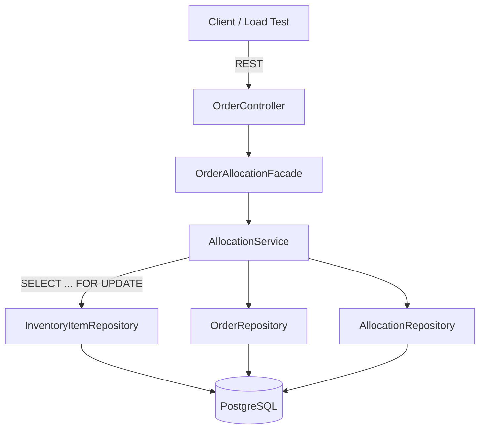
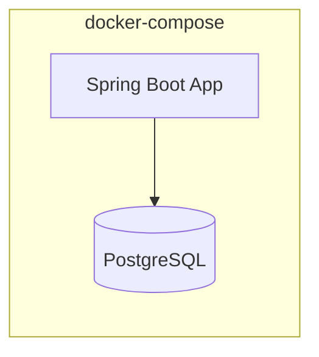

# Architecture

## 1. Component Overview

- **OrderController** — REST layer; request validation only, no business logic.
- **OrderAllocationFacade / AllocationService** — the core: allocation
  rule, locking strategy, idempotency check. This is where the interesting
  code lives.
- **InventoryItemRepository / OrderRepository / AllocationRepository** —
  Spring Data JPA repositories.

## 2. Concurrency Strategy

**Decision: pessimistic locking**, via `findByIdForUpdate` (`SELECT ...
FOR UPDATE`) on the `InventoryItem` row for the duration of the allocation.
The idempotency lookup happens *after* the row lock is acquired, so a
concurrent retry with the same key waits for the winner to commit and then
reads its stored order, instead of racing to create a second one.

Optimistic locking (`@Version`, retry-on-conflict) was the original
candidate (see `PROPOSAL.md` O1) but pessimistic locking was implemented
first because it's simpler to reason about for a single hot row, and the
project's correctness story (zero overselling) doesn't depend on
throughput under low contention. A written before/after benchmark
comparing the two remains a stretch goal, not yet done.

| Strategy | Mechanism | Trade-off |
|---|---|---|
| Pessimistic locking (current) | `SELECT ... FOR UPDATE` on the `InventoryItem` row | Simple to reason about; serializes contention on hot items, higher latency under load |
| Optimistic locking (not yet built) | `@Version` column; retry on `OptimisticLockException` | Better throughput when contention is low; wasted work and added latency when contention is high |

## 3. Transactional Integrity

- The allocation decrement, the order save, and the `Allocation` record
  are written inside the same `@Transactional` boundary.
- Insufficient stock is treated as a normal business outcome, not an
  error: the order is saved as `FAILED` (with a reason) rather than
  thrown, so the transaction commits and the rejection is recorded instead
  of rolling back and vanishing.

## 4. Idempotency

See ADR-0002 for the full decision. In short: each order carries a
client-supplied `Idempotency-Key`, scoped together with a SHA-256 hash of
the request payload (`itemId` + `quantityRequested`). A retry with the
same key and the same payload returns the original order; a retry with
the same key and a *different* payload is rejected with `422`.

## 5. Deployment

- Local: `docker compose up -d` starts Postgres; `./mvnw spring-boot:run`
  starts the app (Spring Boot's Docker Compose support can also start
  Postgres automatically).
- CI: GitHub Actions runs build + test on every push and PR (`ci.yml`).

## 6. What This Project Deliberately Leaves Out (for now)

- **Redis caching** — considered in the original proposal for inventory
  reads, not built. The allocation path always re-reads the database
  inside its transaction regardless (FR7), so a cache would only help
  read-only status endpoints, which don't exist yet either.
- **Message queue-based processing** — would decouple intake from
  allocation, but adds infrastructure the concurrency story doesn't need
  to prove its point. Listed as a stretch goal.
- **Microservices split** — a single service is sufficient to demonstrate
  the concurrency/consistency problem; splitting it would trade clarity
  for distributed-transaction complexity out of scope here.
- **Frontend** — the API and its tests are the deliverable; a UI would
  not add to the argument this project is making.
