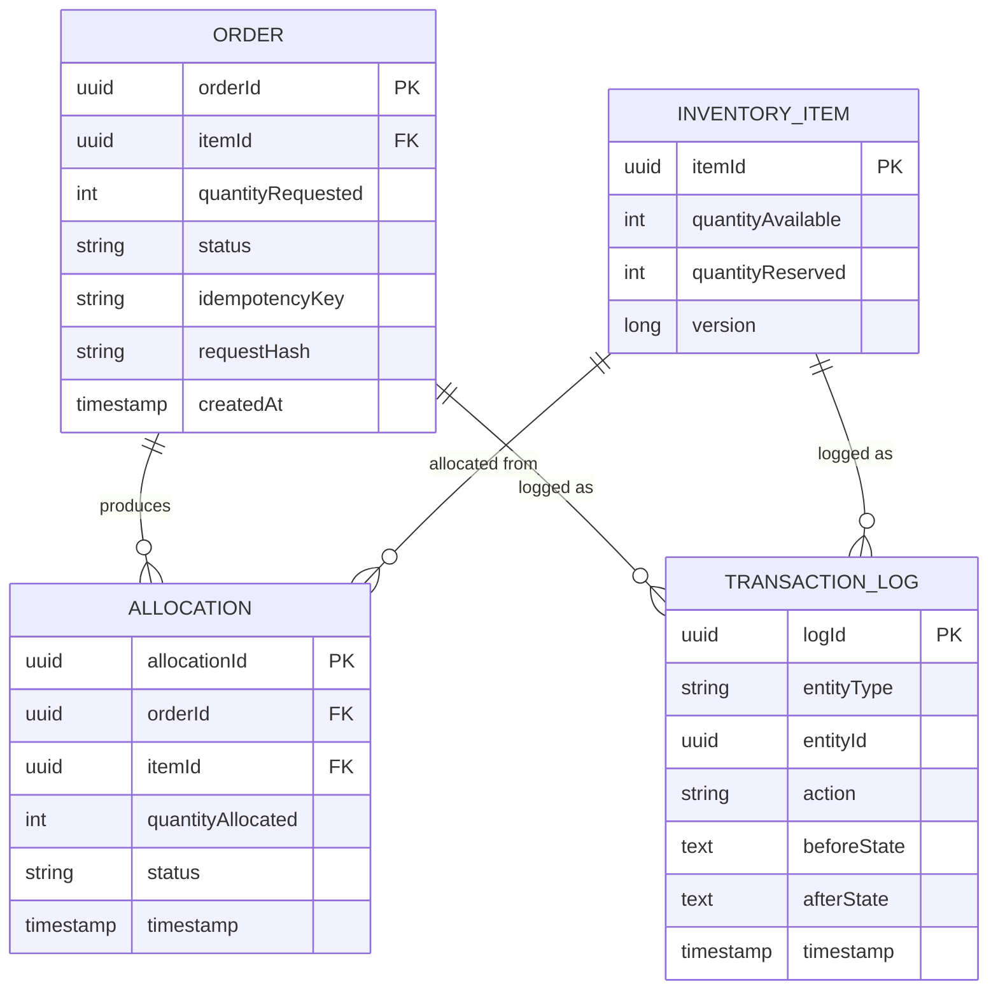
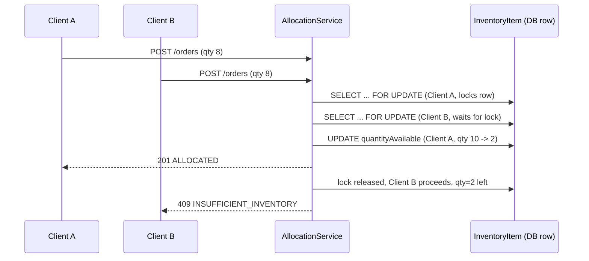

# Software Requirements Specification (SRS)

> Condensed SRS for a solo project. Covers system overview, data model, and
> API contract. See `REQUIREMENTS.md` for the full functional/non-functional
> requirement list and `PROPOSAL.md` for scope and objectives.

## 1. System Overview

The Order Allocation & Transaction Engine is a standalone Spring Boot
backend service. It exposes a REST API for submitting orders against a
fixed pool of inventory items, allocates them under concurrency-safe rules,
and records every state change to an append-only transaction log.

**Assumptions**
- Single instance, single PostgreSQL database.
- No authentication/authorization layer (out of scope — this is an
  internal engine, not a public-facing service).
- Clients are trusted to generate their own idempotency keys.

**Constraints**
- Java 21, Spring Boot 3.x, PostgreSQL, Docker.

## 2. Data Model

### 2.1 Entities

**Order**
| Field | Type | Notes |
|---|---|---|
| orderId | UUID | primary key |
| itemId | UUID/FK | references InventoryItem |
| quantityRequested | int | > 0 |
| status | enum | PENDING, ALLOCATED, FAILED |
| idempotencyKey | string | unique |
| requestHash | string | SHA-256 of the request payload — see ADR-0002 |
| createdAt | timestamp | |

**InventoryItem**
| Field | Type | Notes |
|---|---|---|
| itemId | UUID | primary key |
| quantityAvailable | int | |
| quantityReserved | int | |
| version | long | optimistic-locking column (`@Version`) |

**Allocation**
| Field | Type | Notes |
|---|---|---|
| allocationId | UUID | primary key |
| orderId | UUID/FK | |
| itemId | UUID/FK | |
| quantityAllocated | int | |
| status | enum | |
| timestamp | timestamp | |

**TransactionLog**
| Field | Type | Notes |
|---|---|---|
| logId | UUID | primary key |
| entityType | string | e.g. "Order", "InventoryItem" |
| entityId | UUID | |
| action | string | e.g. ALLOCATE, ROLLBACK, REJECT |
| beforeState | JSON/text | snapshot before the change |
| afterState | JSON/text | snapshot after the change |
| timestamp | timestamp | |

### 2.2 Entity Relationship Diagram (Mermaid)



## 3. API Contract

### `POST /api/orders`
Submit a new order. Requires an `Idempotency-Key` header.

Request:
```json
{
  "itemId": "uuid",
  "quantityRequested": 10
}
```

Response `201 Created`:
```json
{
  "orderId": "uuid",
  "status": "ALLOCATED",
  "quantityAllocated": 10
}
```

Response `409 Conflict` (insufficient stock, all-or-nothing policy — see ADR-0001):
```json
{
  "orderId": "uuid",
  "status": "FAILED",
  "reason": "INSUFFICIENT_INVENTORY",
  "quantityAvailable": 4
}
```

Response `422 Unprocessable Entity` (idempotency key reused with a
different payload — see ADR-0002):
```json
{
  "status": 422,
  "error": "Unprocessable Entity",
  "message": "Idempotency-Key '...' was already used with a different request"
}
```

### `GET /api/orders/{orderId}`
Returns current order status.

### `GET /api/orders/{orderId}/history`
Returns the full transaction-log history for the order (reconstructed
audit trail — see FR10).

### `GET /api/inventory/{itemId}`
Returns current `quantityAvailable` / `quantityReserved` for an item.

## 4. Sequence: Concurrent Allocation



## 5. Error Handling Summary

| Condition | HTTP Status | Response |
|---|---|---|
| Invalid quantity / unknown item | 400 / 404 | validation error |
| Duplicate idempotency key, same payload | 200/201 | original result returned |
| Duplicate idempotency key, different payload | 422 | rejected — see ADR-0002 |
| Insufficient inventory | 409 | order saved as FAILED |
| Unexpected server error mid-allocation | 500 | generic error, logged server-side |
