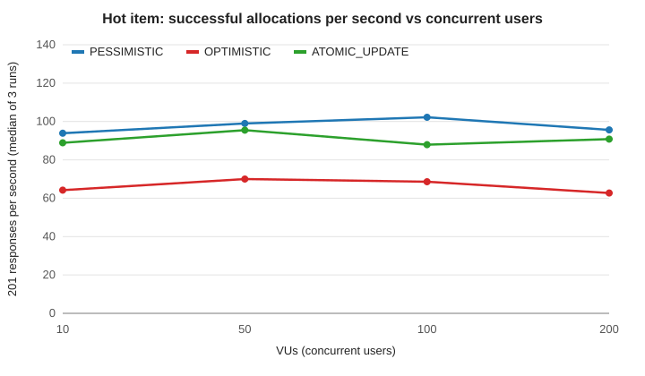

# Benchmarks: locking strategies under load

How the three `allocation.locking-mode` strategies (`PESSIMISTIC`, `OPTIMISTIC`, `ATOMIC_UPDATE`)
behave on `POST /api/orders`. Run on 2026-11-18 with the scripts in [`load-tests/`](../load-tests/README.md).

**Read these as relative numbers from one small laptop**, not as capacity figures. The app, Postgres
and k6 all compete for the same 6 logical cores, and repeats of the same run vary a lot (see the
min-max column).

## Machine

| | |
|---|---|
| CPU | 13th Gen Intel Core i3-1305U (5 cores, 6 logical) |
| RAM | 7.7 GB |
| OS | Windows 11 Home Single Language 10.0.26200 |
| JDK | Java 26.0.1 (build 26.0.1+8-34); the project targets Java 21 |
| App | Spring Boot 3.5.16, run from the built jar on the host, default Hikari pool (10 connections) |
| Postgres | 18.6 in Docker (`postgres:18`) |
| Docker | Docker Desktop 29.4.1 on WSL2, 6 CPUs, 3.7 GB memory |
| k6 | v2.4.0, in Docker (`grafana/k6`) |

## Method

- For each mode the app starts fresh from the jar, then runs one **20 s warm-up** (spread, 20 VUs) that is discarded.
- Each measured run lasts **30 s** and is repeated **3 times**; the tables show the **median** (req/s also shows min-max).
- `allocation`, `orders` and `inventory_item` are **truncated before every run**. Every request has a unique `Idempotency-Key` and orders quantity 1.
- Initial stock is **100,000,000** per item, so stock never runs out and every request is a real decrement (with a small stock the hot item would run dry and mostly measure the 409 rejection path, which writes nothing).
- **hot**: all VUs order the same item. **spread**: each request picks one of 100 items at random.
- After every run, SQL checks that no item has negative stock and that `quantity_available + sum(allocated) = initial stock` for every item.
- The app logs no SQL (`--spring.jpa.show-sql=false`); everything else is the default configuration.

Columns: `req/s` counts every response, including fast 503s. `ok/s` counts only 201 responses. `409s`, `503s` and
`retries` are per 30 s run. `503` is a request that lost 5 optimistic attempts. `oversell` is the number of invariant violations.

## Results



### Scenario: hot

| Mode | VUs | req/s (min-max of 3) | ok/s | p50 ms | p95 ms | p99 ms | error % | 409s | 503s | retries | oversell |
|---|--:|--:|--:|--:|--:|--:|--:|--:|--:|--:|--:|
| PESSIMISTIC | 10 | 93.9 (64.6-100.8) | 93.9 | 35.2 | 605.5 | 1285.5 | 0 | 0 | 0 | 0 | 0 |
| PESSIMISTIC | 50 | 99 (43.8-101.2) | 99 | 505.2 | 646 | 708.6 | 0 | 0 | 0 | 0 | 0 |
| PESSIMISTIC | 100 | 102.2 (97.9-103.1) | 102.2 | 1011.2 | 1199.2 | 1274.2 | 0 | 0 | 0 | 0 | 0 |
| PESSIMISTIC | 200 | 95.6 (89.2-103.1) | 95.6 | 2144.4 | 2606.2 | 2717.1 | 0 | 0 | 0 | 0 | 0 |
| OPTIMISTIC | 10 | 74.5 (46.4-90.9) | 64.2 | 50.6 | 340.1 | 395.6 | 13.81 | 0 | 303 | 3430 | 0 |
| OPTIMISTIC | 50 | 104.3 (103-135.5) | 70 | 198.2 | 595 | 826 | 35.35 | 0 | 1090 | 7585 | 0 |
| OPTIMISTIC | 100 | 131.1 (127-134.9) | 68.6 | 452.2 | 1137 | 1422 | 46.67 | 0 | 1788 | 10670 | 0 |
| OPTIMISTIC | 200 | 124.6 (91.2-125.6) | 62.7 | 1038.2 | 1789.5 | 2787.9 | 49.46 | 0 | 1725 | 10125 | 0 |
| ATOMIC_UPDATE | 10 | 88.9 (85.5-91.4) | 88.9 | 76.1 | 322.1 | 523.8 | 0 | 0 | 0 | 0 | 0 |
| ATOMIC_UPDATE | 50 | 95.5 (92.2-97) | 95.5 | 512.5 | 758 | 905.6 | 0 | 0 | 0 | 0 | 0 |
| ATOMIC_UPDATE | 100 | 87.9 (84.7-92.7) | 87.9 | 1111.4 | 1590.1 | 2240.2 | 0 | 0 | 0 | 0 | 0 |
| ATOMIC_UPDATE | 200 | 90.8 (86.9-94.7) | 90.8 | 2280.4 | 2979 | 3164.1 | 0 | 0 | 0 | 0 | 0 |

### Scenario: spread

| Mode | VUs | req/s (min-max of 3) | ok/s | p50 ms | p95 ms | p99 ms | error % | 409s | 503s | retries | oversell |
|---|--:|--:|--:|--:|--:|--:|--:|--:|--:|--:|--:|
| PESSIMISTIC | 10 | 437.6 (395.1-445.9) | 437.6 | 18.8 | 39.6 | 65.9 | 0 | 0 | 0 | 0 | 0 |
| PESSIMISTIC | 50 | 470.9 (359.4-493.3) | 470.9 | 93.7 | 177.5 | 260.4 | 0 | 0 | 0 | 0 | 0 |
| PESSIMISTIC | 100 | 467.9 (320.2-479.9) | 467.9 | 193 | 345.4 | 447 | 0 | 0 | 0 | 0 | 0 |
| PESSIMISTIC | 200 | 442.1 (408.1-459.4) | 442.1 | 433.8 | 653 | 790.2 | 0 | 0 | 0 | 0 | 0 |
| OPTIMISTIC | 10 | 326.1 (322.2-333.9) | 326.1 | 18 | 45.3 | 75.5 | 0.01 | 0 | 0 | 350 | 0 |
| OPTIMISTIC | 50 | 294.7 (172.6-370.5) | 294.7 | 133.3 | 386.4 | 672.8 | 0 | 0 | 0 | 525 | 0 |
| OPTIMISTIC | 100 | 314.7 (238.8-389.8) | 314.7 | 288.3 | 556.5 | 973.5 | 0 | 0 | 0 | 555 | 0 |
| OPTIMISTIC | 200 | 411.6 (395.8-418.9) | 411.6 | 453.6 | 821.5 | 1198.1 | 0 | 0 | 0 | 781 | 0 |
| ATOMIC_UPDATE | 10 | 271.7 (222.7-328.6) | 271.7 | 30.4 | 76.9 | 116.8 | 0 | 0 | 0 | 0 | 0 |
| ATOMIC_UPDATE | 50 | 399.1 (380.9-434.7) | 399.1 | 111.1 | 213.7 | 274.7 | 0 | 0 | 0 | 0 | 0 |
| ATOMIC_UPDATE | 100 | 376.4 (362.4-436.7) | 375.9 | 205.7 | 389.3 | 538.2 | 0 | 0 | 0 | 0 | 0 |
| ATOMIC_UPDATE | 200 | 308.5 (300.8-326.6) | 308.5 | 611 | 1116.3 | 1226.4 | 0 | 0 | 0 | 0 | 0 |

## Findings

What the numbers show, nothing more:

- **Correctness held in all 72 runs.** No item went negative, `quantity_available + allocated = initial stock` held for every item, and the number of allocation rows matched the 201 responses in every run.
- **Hot item, `PESSIMISTIC` and `ATOMIC_UPDATE`:** both stay at about 88-102 successful allocations/s whether there are 10 or 200 VUs, with 0 errors. Extra users only add waiting: p50 roughly doubles each time VUs double from 50 to 200 (505 -> 1,011 -> 2,144 ms for `PESSIMISTIC`). `PESSIMISTIC` has the higher median at every VU count (by 4-16%), but the ranges overlap at 10, 50 and 200 VUs; only at 100 VUs are they clearly apart (97.9-103.1 vs 84.7-92.7 req/s).
- **Hot item, `OPTIMISTIC`:** the share of requests that fail with 503 after 5 attempts grows from 13.8% (10 VUs) to 49.5% (200 VUs), with 3,430 to 10,670 retries per run. Successful allocations are 63-70/s, below the other two modes. Its higher `req/s` (up to 131) comes from failed requests returning quickly, which is why the chart uses `ok/s`.
- **Spread:** the median 409 and 503 counts are 0 in every cell. `OPTIMISTIC` at 10 VUs shows a 0.01% error rate (about 1 request in 10,000); its cause was not investigated. `PESSIMISTIC` has the highest median `req/s` at every VU count (438-471), but ranges overlap in several cells. The ranges are clearly apart only for `PESSIMISTIC` over the other two at 10 VUs, and over `ATOMIC_UPDATE` at 200 VUs.
- **`ATOMIC_UPDATE` was not faster than `PESSIMISTIC` in this setup:** a slightly lower median on the hot item and a lower median on spread at every VU count (272-399 vs 438-471 req/s).

## Notes and limits

- Single machine, 3 repeats, 30 s runs: treat differences inside the min-max ranges as noise. Several `PESSIMISTIC` and `OPTIMISTIC` ranges are wide (for example `PESSIMISTIC` hot at 50 VUs: 43.8-101.2 req/s).
- At 100-200 VUs the default Hikari pool (10 connections) and the shared CPU limit every mode; throughput on spread is flat while latency climbs. Pool size and Postgres settings were not tuned.
- Not measured: a scenario where stock runs out during the run (oversell under exhaustion is covered by the concurrency tests, not by this benchmark), other `QTY` values, and different pool sizes.
- Optimistic retry settings were the defaults: 5 attempts, 10 ms base backoff with jitter.

## Reproduce

```powershell
.\load-tests\run-matrix.ps1      # about 55 min; app and results under load-tests/results/<run>/
.\load-tests\summarize.ps1       # median of the repeats, writes summary.csv / summary.json
.\load-tests\make-report.ps1     # markdown tables + docs/img/hot-throughput.svg
```
