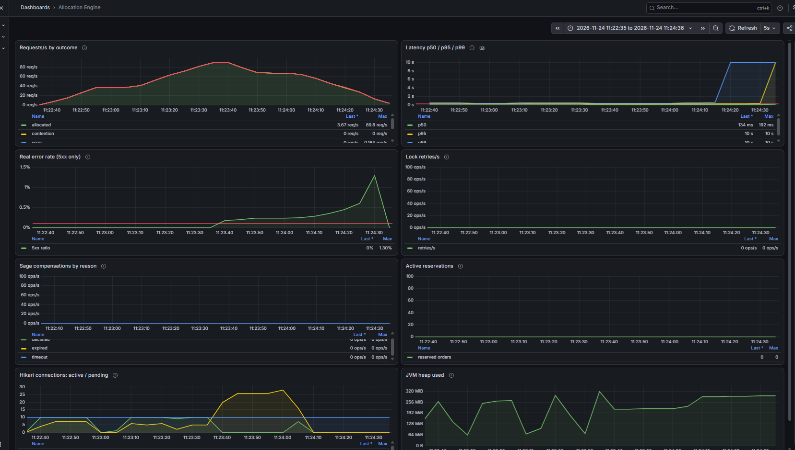
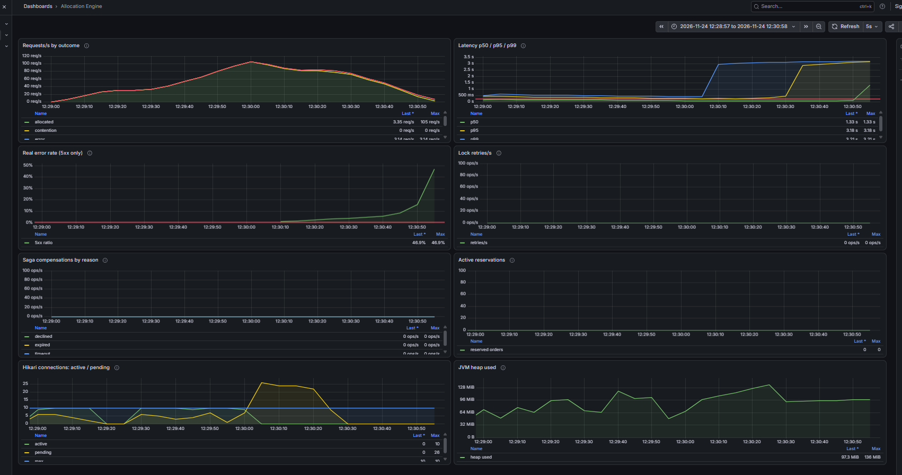
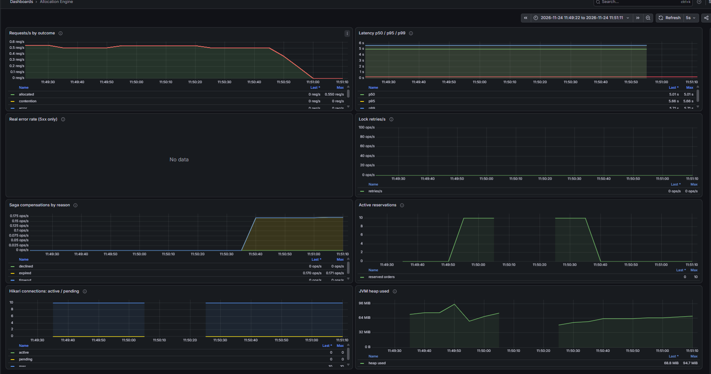
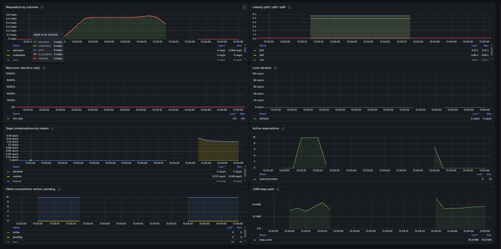

# Chaos experiments

Two failure experiments against the running system, each done **before** and **after** the resilience fixes
(OAE-34), so every claim in the "after" part can be compared with a number measured on the same setup.

| # | Experiment | Script |
|---|---|---|
| 1 | Kill PostgreSQL during load | `load-tests/chaos-db.ps1` |
| 2 | Kill the app in the middle of checkouts | `load-tests/chaos-app.ps1` (k6: `load-tests/checkout.js`) |

> **Read the numbers as indicative.** Everything ran on one Windows laptop that was heavily loaded the whole time
> (about 100% CPU and under 1 GB free RAM from other programs, Docker Desktop VM with 3.7 GB), with the app, Postgres,
> Prometheus, Grafana, Jaeger and k6 all on the same machine. Absolute latencies and throughput would differ on
> dedicated hardware. The *shape* of the behaviour (what hangs, what fails, what recovers, whether data stays correct)
> does not depend on that. Nothing here was rounded or tuned; every figure comes from the run it is attached to.

How a run is measured (same for both experiments):

- k6 writes one CSV row per request (`--out csv=...`), with timestamp and HTTP status. `chaos-summary.ps1` turns it
  into 5-second buckets. k6 stamps a request when it **finishes**, so a request that hangs for 25 s is counted in the
  bucket where it ended.
- Independent probes (3 order POSTs and 1 readiness GET, about once a second each, from the host) keep what a client
  actually received, including the response body. k6 does not keep bodies.
- After the run: SQL invariants on the items the run created, a check for orphan orders, and the app log of the window.
- The app runs as the `app` compose service; the Grafana dashboard is the provisioned "Allocation Engine".

---

## 1. Kill PostgreSQL during load

### Run: BEFORE fixes (no resilience changes yet)

#### Hypothesis

When the database disappears for 20 s:

1. requests fail fast with a clean 5xx (not hang),
2. readiness goes DOWN so an orchestrator would stop sending traffic,
3. once Postgres is back the service recovers by itself, within a few seconds and without restarting the app,
4. no data is lost or corrupted: stock never goes negative, and `available + reserved + allocated/confirmed` equals the
   initial stock.

#### Experiment

- Stack: `docker compose --profile app up -d --build`. App image as built from `Dockerfile`, default settings
  (Hikari `connection-timeout` = 30 s, the Hikari default).
- Load: `spread.js`, 20 VUs, 60 s, 50 items x 1000 stock, `POST /api/orders`, after a 20 s unrecorded warm-up.
- t=30 s: `docker compose stop postgres`. 20 s after the stop command returned: `docker compose start postgres`.

Exact timeline of the run (t = seconds after the first order request, local time 11:23:05):

| Event | t |
|---|---|
| `docker compose stop postgres` issued | 30.0 s |
| stop command returned (container stopped) | 33.4 s |
| `docker compose start postgres` issued | 53.4 s |
| Postgres container reported healthy | 60.3 s |
| k6 finished | 60.5 s |

Postgres was therefore down for about 20 s (33.4 to 53.4 s) plus its start-up time.

#### Observed

20 VUs, 3895 requests: **3886 x 201, 9 x 500**, no 409 and no timeouts.

| Bucket | Requests | 201 | 409 | 5xx | timeout / conn. error | p95 ms | max ms |
|---|---:|---:|---:|---:|---:|---:|---:|
| 0-5 s | 446 | 446 | 0 | 0 | 0 | 547 | 827 |
| 5-10 s | 632 | 632 | 0 | 0 | 0 | 277 | 441 |
| 10-15 s | 501 | 501 | 0 | 0 | 0 | 434 | 707 |
| 15-20 s | 504 | 504 | 0 | 0 | 0 | 334 | 563 |
| 20-25 s | 646 | 646 | 0 | 0 | 0 | 281 | 455 |
| 25-30 s | 781 | 781 | 0 | 0 | 0 | 225 | 332 |
| **30-35 s** | 127 | 118 | 0 | **9** | 0 | 589 | 719 |
| **35-40 s** | 0 | 0 | 0 | 0 | 0 | - | - |
| **40-45 s** | 0 | 0 | 0 | 0 | 0 | - | - |
| **45-50 s** | 0 | 0 | 0 | 0 | 0 | - | - |
| **50-55 s** | 0 | 0 | 0 | 0 | 0 | - | - |
| **55-60 s** | 184 | 184 | 0 | 0 | 0 | 25,938 | 26,052 |

*Grafana, whole run (11:22:35 to 11:24:36). Requests/s by outcome, latency p50/p95/p99, 5xx error rate and Hikari
active/pending. The latency panel tops out at 10 s because the histogram's largest bucket is 10 s; the real maximum was
26.0 s (table above). Rates are 1-minute averages, so the dip is smoothed.*

What a client got, measured:

| Question | Observed |
|---|---|
| Status codes during the outage | **9 x 500**, all finishing at t=31.4 s, the moment the connections were cut. After that **no response at all** between t=35 s and about t=55 s: nothing failed, nothing succeeded. |
| How long did requests hang? | 3 order probes started at t=37.7 s each took **20.1 to 20.3 s** and then returned **201**. k6: **20 requests took 1 s or more, i.e. one per VU, all of them hung for about 20 to 26 s (slowest 26.05 s) and all returned 201**; they finished in the 55-60 s bucket, which is why that bucket's p95 is 25.9 s (the other requests in that bucket are normal ones after recovery). |
| Response body of the 500s | Not captured by a client in this run (the 9 failures were k6 requests and the probes happened not to be among them). The server's catch-all handler returns `{"status":500,"error":"Internal Server Error","message":"Unexpected error occurred"}` (`GlobalExceptionHandler#handleUnexpected`), and the log has a matching `Unhandled exception` ERROR for each of the 9. No `Retry-After`. |
| Hikari timeouts in the log | **0** "Connection is not available" messages. The longest wait (26.05 s) was shorter than the 30 s `connection-timeout`, so requests waited and then succeeded. **With an outage longer than about 30 s these requests would have failed with a 500 after 30 s each.** |
| Log volume | 6947 log lines in the window: **50 ERROR lines and 2847 stack-trace lines**. The 9 failures each logged `Unhandled exception` plus the JDBC errors (`FATAL: terminating connection due to administrator command`, `An I/O error occurred while sending to the backend`), 5 also `Application exception overridden by rollback exception`. |
| Readiness during the outage | **Never DOWN.** The probe at t=37.5 s got **no answer within its 10 s timeout**. The probe at t=49.1 s waited 8.7 s and then got `{"status":"UP"}` once the database was back at about t=58 s. The app logged `Health contributor ... DataSourceHealthIndicator (db) took 23157ms to respond` (and 20235 ms). |
| Time to recover | First 201 after `start postgres` was issued: **4.0 s after the command** (t=57.4 s). Those were the waiting requests completing, so there was no extra reconnect delay. New probes answered in 11 to 96 ms from t=58.8 s. No app restart needed. |
| Invariants | **Held.** 51 items (50 k6 + 1 probe): 0 negative stock; 0 items where `available + reserved + allocated/confirmed != 1000`; totals 47,096 + 0 + 3,904 = 51,000 = initial. |
| Orphan orders | **None** (no PENDING / RESERVED / PAID rows). Orders by status: ALLOCATED=3904. |

An earlier run of the same experiment (same code and settings, but my probe only sampled readiness every 2 s and was
blocked by its own hanging POST, so it missed the readiness data) gave the same picture: 3428 requests, 3418 x 201 and
10 x 500 at the moment of the stop, slowest request 26.4 s, first 201 after the start command 3.8 s, invariants and
orphans clean. I kept the second run as the record because its probes are complete.

#### Analysis

Hypothesis 4 (data stays correct) **held**; hypotheses 1 and 2 **did not**; hypothesis 3 **held for recovery speed**.

1. **Data integrity is not at risk.** Every stock move and its order row commit in one transaction, so when the
   connection was cut mid-commit the transaction rolled back as a whole. The 9 failed requests left neither a
   half-allocated order nor a stock change.
2. **The system hangs instead of failing fast.** With Hikari's default 30 s `connection-timeout`, a request waits for
   a connection for up to 30 s. During a 20 s outage that is *longer than the outage itself*, so all 20 VUs (and every
   probe) simply stopped for about 25 s. A client with a normal timeout would have given up and retried, adding load
   as soon as the database returns. This is the real gap: the failure is silent and slow, not loud and quick.
3. **The 500 is the wrong answer for "database unavailable".** It is an internal-error status with no `Retry-After`,
   and it writes a full stack trace per request (2847 stack-trace lines for 9 failures). A 503 with `Retry-After` says
   "temporary, try again", and the log should say it once.
4. **Readiness does not do its job.** The `db` health check waits for a connection just like a request does, so during
   the outage the readiness endpoint hung (a 10 s client timeout, or 8.7 s then UP) instead of answering DOWN. An
   orchestrator with a 1 to 3 s probe timeout would treat it as failing, but the app itself never reports DOWN.
5. **Recovery itself is good.** Hikari reconnects on its own; the first success came 4.0 s after the start command and
   the app was never restarted.

Fixes this points to (OAE-34): lower the Hikari connection timeout so requests fail in seconds; map "database
unavailable" to 503 + `Retry-After`, logged once at WARN; make readiness fail fast and report DOWN.

### Run: AFTER fixes

What changed (commit `fix(resilience): fail fast and answer 503 when the database is down`): Hikari
`connection-timeout` 30 s to 3 s (`validation-timeout` 2 s); "database unavailable" errors (no connection from the pool,
connection lost mid-request, including the wrappers seen on in-flight requests) answered with **503 + `Retry-After: 5`**
and one rate-limited WARN line instead of a 500 with a stack trace; Hibernate's per-failure `SqlExceptionHelper` logging
switched off so each failure is logged once, by the handler. Everything else is as in the BEFORE run: same script, same
load, same 20 s outage, same machine.

Timeline (t = seconds after the first order request, local time 12:29:27): `stop postgres` issued 30.0 s, returned
33.5 s; `start postgres` issued 53.5 s; container healthy 60.0 s.

20 VUs, 4810 requests: **4640 x 201, 170 x 503, 0 x 500**, no 409, no timeouts.

| Bucket | Requests | 201 | 409 | 5xx | timeout / conn. error | p95 ms | max ms |
|---|---:|---:|---:|---:|---:|---:|---:|
| 0-5 s | 466 | 466 | 0 | 0 | 0 | 386 | 550 |
| 5-10 s | 692 | 692 | 0 | 0 | 0 | 252 | 425 |
| 10-15 s | 640 | 640 | 0 | 0 | 0 | 311 | 761 |
| 15-20 s | 913 | 913 | 0 | 0 | 0 | 206 | 381 |
| 20-25 s | 862 | 862 | 0 | 0 | 0 | 212 | 394 |
| 25-30 s | 669 | 669 | 0 | 0 | 0 | 273 | 471 |
| **30-35 s** | 186 | 156 | 0 | **30** | 0 | 3,093 | 3,135 |
| **35-40 s** | 20 | 0 | 0 | **20** | 0 | 3,104 | 3,106 |
| **40-45 s** | 40 | 0 | 0 | **40** | 0 | 3,039 | 3,050 |
| **45-50 s** | 40 | 0 | 0 | **40** | 0 | 3,068 | 3,083 |
| **50-55 s** | 20 | 0 | 0 | **20** | 0 | 3,049 | 3,052 |
| **55-60 s** | 137 | 117 | 0 | **20** | 0 | 3,055 | 3,131 |

*Grafana, whole run (12:28:57 to 12:30:58), same panels as the BEFORE screenshot. The 5xx ratio now rises during the
outage (a 1-minute window, so it keeps climbing until the window is full of outage), latency tops out at about 3 s (the
connection timeout) instead of 10 s+, and Hikari pending reaches 26 (28 before): with 20 VUs and probes all asking for a
connection, the queue is still as deep as the clients are many, but each waiter now leaves after 3 s.*

What a client got:

| Question | Observed |
|---|---|
| Status codes | **503 with `Retry-After: 5`** and the body `{"error":"Service Unavailable","message":"The service is temporarily unavailable. Please retry shortly.","status":503,...}`. No 500 at all. |
| How long did a request wait? | Every failed request was answered in **3.0 to 3.2 s** (the connection timeout). Slowest request of the whole run **3,135 ms** (was 26,052 ms). 15 of 33 order probes got 503, none took longer than 3,146 ms. |
| Readiness during the outage | **503 `{"status":"DOWN"}`**, answered in 3.0 to 3.4 s, for every probe that started between t=34.9 s and t=51.5 s (5 probes). First `UP` again at t=55.5 s. Before the fix it never said DOWN. |
| Log | 10 ERROR lines (was 50), 24 WARN. The handler wrote **3 WARN lines for 213 failures** ("Database unavailable, answering 503: ... (72 similar failures were not logged in the last 10 s)"), no stack trace. 0 `Unhandled exception`. |
| Time to recover | First 201 after `start postgres` was issued: **3.8 s after the command** (t=57.3 s); BEFORE it was 4.0 s. The last 503 finished at t=56.3 s. |
| Invariants | **Held.** 51 items, 0 negative stock, 0 mismatched items; 46,342 available + 0 reserved + 4,658 allocated = 51,000 = initial. |
| Orphan orders | **None.** ALLOCATED = 4658. |

Residual noise, not fixed: the log still contains stack traces written by Spring's transaction interceptor
("Application exception overridden by rollback exception", 9, for the requests caught in flight at the instant of the
stop) and by Boot's health indicator ("DataSource health check failed", 8, one per failed readiness probe). They come from
framework loggers, not from the handler. The "stack-trace lines" count in the run output (3,932) is dominated by those
few deep traces, so it is a poor measure; the number of ERROR lines (10) is the better one.

How I got here (kept honest): this is the **third** AFTER run. The first (after the first version of the fix) still had
10 x 500 and 593 ERROR lines: requests caught in flight failed inside a `JpaSystemException` wrapper that was not mapped,
and Hibernate logged every failed connection attempt twice. The second had 6 x 500, all "Unable to rollback" caused by the
pool's `Connection is closed` (no SQLSTATE). Each gap was closed and tested, the fix commit was amended (nothing was
pushed), and only this final run is the record.

### Before and after, DB outage (20 VUs, 60 s, Postgres stopped about 20 s)

| | BEFORE | AFTER |
|---|---|---|
| Requests that hung (no answer for 20 s or more) | **20** (every VU's request, plus the 3 order probes), answered 201 only after Postgres was back, **up to 26 s** | **0**; every failed request was answered in about 3 s |
| Max latency | **26,052 ms** | **3,135 ms** |
| 5xx type | **500** (9), unhandled, with a stack trace each, no `Retry-After` | **503** (170) with `Retry-After: 5` and a generic body; **0 x 500** |
| Readiness during the outage | never DOWN: hung (10 s client timeout, or 8.7 s then UP) | **503 DOWN in about 3 s** |
| Time to recover (first 201 after `start postgres`) | 4.0 s | 3.8 s |
| Stock invariant | held (51,000 = 51,000) | held (51,000 = 51,000) |
| Orphan orders | none | none |
| ERROR log lines | 50 (9 with a full stack trace) | 10 (framework loggers); 3 handler WARN lines for 213 failures |

A trade-off to know: during the outage the system now *rejects* requests (170 x 503) that used to *wait* (and eventually
succeed, because this outage was shorter than 30 s). That is the intended behaviour (a client can retry or back off
immediately instead of holding a connection for 25 s), but a client that does not retry sees more failures for a short
outage. With an outage longer than 30 s the old behaviour would also have failed, only after 30 s per request.

---

## 2. Kill the app in the middle of checkouts

> **Update (2026-11-27):** the expiry job now requests a refund for every expired order (fixed in
> [#27](https://github.com/ChamaniNiroshani/order-allocation-engine/pull/27)). It is not retried yet: see
> [#28](https://github.com/ChamaniNiroshani/order-allocation-engine/issues/28). The BEFORE and AFTER results below are
> unchanged, as the record of those runs; where they say the expiry path never refunds, that was true at the time.

### Run: BEFORE fixes (no resilience changes yet)

#### Hypothesis

A checkout reserves stock in one transaction, then calls the payment provider, then confirms in another transaction.
If the app process dies in between (`kill`, not a graceful stop):

1. the orders that were mid-payment stay RESERVED in the database, with their stock reserved,
2. after the app restarts, the expiry job finds them and expires them, so **RESERVED returns to 0 with no manual
   clean-up**, about one reservation TTL (plus the restart) after the kill,
3. stock returns **exactly** to what it was (`available + reserved + confirmed = initial`, nothing leaked, nothing
   negative),
4. any order that was PAID but not yet confirmed at the kill is confirmed by the recovery path.

#### Experiment

- App container with three overrides for this experiment only (container environment, not new defaults):
  `PAYMENT_FAKE_LATENCY_MS=5000`, `CHECKOUT_RESERVATION_TTL=30s`, `CHECKOUT_EXPIRY_INTERVAL=5s`. With a 5 s payment,
  every VU is always holding one RESERVED order.
- Load: `load-tests/checkout.js`, 10 VUs, 20 items x 1000 stock, `POST /api/checkout`.
- 15 s after the first checkout had completed (about 20 s into the run, when all 10 VUs are mid-payment):
  `docker compose kill app`. Record RESERVED orders and reserved stock, then `docker compose start app`, and poll the
  database every ~1 s until nothing is RESERVED or PAID.

#### Observed

| Question | Observed |
|---|---|
| At the kill | **RESERVED = 10, PAID = 0**, reserved stock = **10 units** (one unit per order); available 19,950 of 20,000. |
| What k6 saw | 40 x 201 before the kill; **75 connection errors** (status 0) after it (the 10 in-flight checkouts were cut, then the VUs retried against a dead port). |
| App back | `start app` issued 2.8 s after the kill; container healthy **18.9 s** after the kill. |
| **Time until RESERVED = 0** | **31.7 s after the kill** (28.9 s after `start app`, 12.8 s after the container was healthy). The count stayed at 10 until 30.6 s and was 0 at 31.7 s. |
| Fate of the 10 stuck orders | **EXPIRED = 10** (none confirmed, none cancelled). |
| Stock | Returned exactly: 20 items, **0 negative**, **0 items** where `available + reserved + allocated/confirmed != 1000`; totals 19,960 available + 0 reserved + 40 confirmed = 20,000 = initial. Reserved stock 10 to 0. |
| PAID orders left, then confirmed by the recovery path | **None existed**, so this path was **not exercised**. The 5 s delay is inside the payment call, *before* the order is marked PAID; the PAID-to-CONFIRMED window is a few milliseconds and the kill did not land in it. This is covered by the integration tests, not by this experiment. |
| Orders by status after | CONFIRMED = 40, EXPIRED = 10. |

*Grafana, whole run (11:49:22 to 11:51:11). "Active reservations" rises to 10, has a gap while the app is dead (nothing
to scrape), shows 10 again after the restart until the expiry job runs, then drops to 0. "Saga compensations by reason"
shows `expired` (about 0.17 ops/s as 10 orders were expired in one 5 s window).*

An earlier attempt of this experiment is **not** counted: a timing bug in my script (k6 writes a row only when a request
finishes, and each checkout takes 5 s) made it kill the app after k6 had already finished, with RESERVED = 0 at the
kill. It tested nothing; I fixed the script and re-ran.

#### Analysis

Hypotheses 1, 2 and 3 **held**; 4 was **not tested** by this run.

1. **Recovery is automatic and correct.** A crash mid-payment leaves orders RESERVED, but nothing is lost: because the
   stock reservation and the order status commit together, the stock is reserved if and only if the order is RESERVED,
   and the expiry job releases both in one transaction. Stock came back exactly.
2. **How long stock stays locked is set by the TTL, not by the restart.** The app was healthy after 18.9 s but orders
   were only expired at 31.7 s, because they are only stale 30 s after they were reserved (plus up to one 5 s job
   interval). With the **default** `checkout.reservation-ttl` of 5 minutes, a crash holds the units of every in-flight
   checkout for up to 5 minutes. That is a business trade-off (a longer TTL protects slow payments from being expired
   under them), not a bug, but it is the number to know.
3. **Open risk this experiment cannot measure: money.** The expiry path releases stock but does **not** call the payment
   gateway's refund. The fake gateway keeps its state in memory and loses it on restart, so here nothing was charged
   at all. With a real provider, a charge that succeeded in the instant before the crash would leave an EXPIRED order
   with a charged customer. A real fix needs a gateway that can be queried (look up the payment by idempotency key
   before expiring, refund if found); I did not change this because there is no data here that shows it, only the code.
4. **Not exercised:** the PAID-then-crash path (see the table) and what a client sees when it retries the same
   `Idempotency-Key` after the restart.

Findings for OAE-34 from this experiment: none that call for a code change by themselves. The gateway call has no
timeout of the orchestrator's own (a slow payment holds the request, and its reservation, for as long as the gateway
takes), which is a design gap visible in the code and consistent with the 5 s waits here, but this run did not measure a
stuck gateway.

### Run: AFTER fixes

The code that matters for a crash mid-checkout (reserve, charge, confirm, expiry) was **not changed** by the fixes: the
BEFORE run showed correct recovery, so there was nothing for this data to fix. The run was repeated on the fixed build to
check that nothing regressed. The only change on this path is the new `payment.timeout` (default 10 s) around the charge
call; with the 5 s payment used here it is never reached, so the experiment is the same. Same overrides, same load, same kill.

| Question | BEFORE | AFTER |
|---|---|---|
| At the kill | RESERVED = 10, PAID = 0, reserved stock 10 units | RESERVED = **7**, PAID = **1**, reserved stock 8 units |
| App healthy again | 18.9 s after the kill | **64.0 s** after the kill (the laptop was busier; not caused by the fixes) |
| **Time until RESERVED = 0** | 31.7 s after the kill (12.8 s after healthy) | **65.3 s** after the kill (**1.3 s** after healthy) |
| Fate of the stuck orders | EXPIRED = 10 | **EXPIRED = 7, CONFIRMED = 1** |
| Stock | exact: 19,960 available + 40 confirmed = 20,000; 0 reserved | exact: 19,966 available + 34 confirmed = 20,000; 0 reserved |
| Negative stock / mismatched items | 0 / 0 | 0 / 0 |
| k6 | 40 x 201, 75 connection errors | 33 x 201, 72 connection errors |

*Grafana, whole run (12:52:42 to 12:55:04). "Active reservations" rises, has a gap while the app is dead, then drops to 0;
"Saga compensations by reason" shows `expired`.*

How to read the times: the time to reach 0 is set by `max(restart time, TTL since the order was reserved) + up to one
expiry interval`. BEFORE, the app was back after 18.9 s, but the orders were only 30 s old at about 30 s, so RESERVED
reached 0 at 31.7 s. AFTER, the app took 64 s to start (a slower, loaded start), so the orders were already stale when the
expiry job first ran and RESERVED reached 0 only 1.3 s after the app was healthy. The two runs are therefore **not
comparable on this number**: it measures how long the laptop took to start the JVM, not a property of the fix.

**New in this run:** one order was **PAID** at the kill (the payment had been recorded, the confirm had not run yet). After
the restart the recovery path confirmed it: **PAID = 1 became CONFIRMED = 1** and its stock left the warehouse (`reserved`
went to 0, `available` did not come back). This is the case the BEFORE run did not exercise; it landed here by chance, so
it is one observation, not a measured rate. The 7 orders that were only RESERVED expired and their stock returned.

The open item from the BEFORE analysis is unchanged: the expiry path releases stock but never calls the gateway's refund,
and the fake gateway cannot show whether a charge was taken. `payment.timeout` handles a gateway that is too slow while
the app is running (refund by key, cancel, release); it does not cover a crash.

---

## What changed, and what the data said

| Change (commit `fix(resilience)`) | Evidence it was needed | Evidence it works |
|---|---|---|
| Hikari `connection-timeout` 30 s to 3 s | requests hung 25 to 26 s during a 20 s outage; readiness hung too | slowest request 3.1 s; readiness DOWN in 3 s |
| "Database unavailable" to 503 + `Retry-After` + one rate-limited WARN | 9 x 500 with a stack trace each | 170 x 503 with `Retry-After: 5`, 0 x 500, 3 WARN lines for 213 failures; unit tests for every exception shape seen, and a test that an unrelated SQL error is still a 500 |
| Cause-chain check for in-flight failures (`JpaSystemException`, `Connection is closed`) | found by the first and second AFTER runs (10, then 6 x 500) | 0 x 500 in the final run |
| `SqlExceptionHelper` logging off | first AFTER run: 593 ERROR lines | 10 ERROR lines |
| `payment.timeout` (default 10 s) in the orchestrator, same path as a gateway timeout | **design gap, not measured by the chaos runs**: the orchestrator had no limit of its own, so a slow gateway held the request and its reservation as long as the gateway took | integration test `SagaPaymentTimeoutScenarioTest`: a 3 s gateway with `payment.timeout=300ms` gives a 502, refund by key, CANCELLED, stock restored, in well under 2.5 s |

Not changed, on purpose: the crash-recovery path (the data showed it correct), and the refund-on-expiry gap (it needs a
real gateway to measure).
